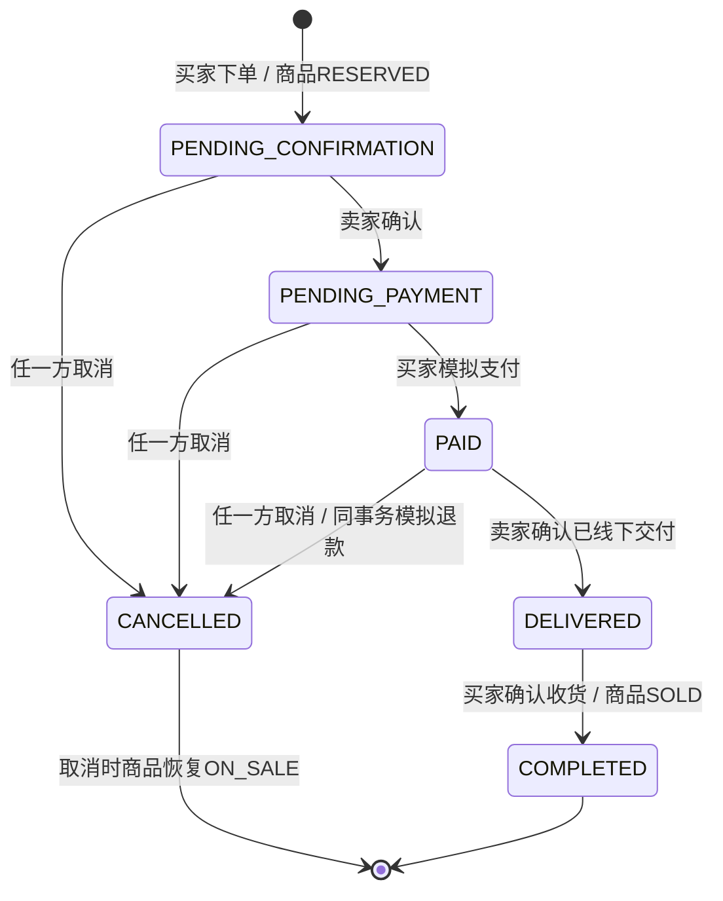

# 阶段六：订单与模拟交易验收报告

日期：2026-10-19。根目录：`D:\FQH_Programs\CampusMarket`。
版本：0.6.0 / versionCode 5。代码及自动化验收完成，设备端 UI 待验证；阶段七未开始。

## 范围核对与功能

已阅读 README、阶段五验收报告、原商品/用户鉴权及事务代码。仓库没有单独的未来分阶段计划文件，
阶段五报告仅注明后续留言与订单未开发，未定义阶段六详细接口或验收步骤；本阶段按照用户本次明确的订单目标实施。
没有开发留言、真实支付、争议处理或管理员后台。

已实现：

- 商品详情下单，买入/卖出订单分页列表，双方可访问的订单详情。
- 卖家确认、买家模拟支付、交付前双方取消、卖家确认线下交付、买家确认收货。
- 下单时保存商品标题、描述、成色、交接地点和价格快照；后续商品修改不改变历史成交信息。
- 订单详情展示当前交易/模拟付款状态、双方昵称、成交金额及完整成功操作流水。
- 加载、空列表、网络失败、重试、分页、防重复点击和危险状态操作二次确认。
- 返回商品详情重新加载，隐藏已预留/售出商品的过时内容；我的发布正确显示交易中/已售。
- 交易中及已售商品在管理界面引导进入卖出订单，后端继续严格禁止编辑、上下架、删除。

Android 沿用 Java + XML、RecyclerView、ExecutorService、Gson、Handler。新页面与旧页面共用
UserApi 的真实 HTTP 传输、SessionStore 登录状态和原鉴权错误处理，没有引入新的运行库。
所有订单、模拟支付和流水通过 Jakarta Servlet、JDBC、MySQL 持久化；没有本地假订单状态。

## 状态机与权限



| 操作 | 身份 | 首次执行要求 | 提交后结果 |
| --- | --- | --- | --- |
| 下单 | 登录买家，且不是卖家本人 | 在售、分类启用、卖家正常 | 待卖家确认，商品RESERVED |
| 确认接单 | 卖家 | PENDING_CONFIRMATION | PENDING_PAYMENT |
| 模拟支付 | 买家 | PENDING_PAYMENT | PAID；模拟支付记录SUCCEEDED |
| 取消 | 买家或卖家 | 待确认/待支付/PAID | CANCELLED，商品ON_SALE；如已支付则REFUNDED |
| 交付 | 卖家 | PAID | DELIVERED；商品仍RESERVED |
| 收货 | 买家 | DELIVERED | COMPLETED，商品SOLD |

交付后禁止取消，避免已交付商品又被恢复可售。所有状态操作先验证参与者与角色，再判断状态。
越权403、过时或非法跳转409、未登录/过期/撤销401；有效会话也不能购买本人商品。
客户端只能请求规定动作，不能直接指定订单状态、成交金额或买卖双方身份。

同一个已成功执行的动作再次请求，返回订单**当前详情**，不会再次扣模拟款、退款、释放商品或新增流水。
未成功过的动作若当前状态不满足，返回409。已取消的原下单请求重放仍返回原已取消订单；
若要再次购买，必须使用新的请求编号。旧取消重试不会释放另一笔新订单已占用的商品。

## 数据库与事务一致性

用户在本机隐藏提示中执行 `005_orders.sql` 迁移成功，随后真实业务账号 JDBC 复核结构版本5。
只新增三张 InnoDB 表，不修改原数据，不授予业务账号DDL权限，不保存管理员密码。
迁移使用 `CREATE TABLE IF NOT EXISTS`、版本号 `GREATEST`，可以重复执行。

- orders：下单快照、双方ID、成交金额、状态、请求UUID、时间。外键、合法状态/非负金额/不可自购CHECK。
- simulated_payments：每订单主键一条，记录真实落库的模拟金额、SUCCEEDED/REFUNDED和时间，不接触任何支付平台。
- order_events：创建与每种成功动作的前后状态、操作者、时间；`(order_id,action)` 唯一。

防重约束：`(buyer_id,request_id)` 唯一；`active_product_id` 为生成列，未取消订单映射商品ID，
取消订单映射NULL，唯一索引保证同商品最多一笔未取消订单（包含已完成订单）。
取消后允许产生新的订单；完成后商品SOLD且旧订单继续占用唯一约束，不能再次成交。

写事务统一使用 READ_COMMITTED，固定先锁商品再锁订单：

1. 下单锁定商品行，检查请求重放、可售状态、双方与分类，读取服务端价格和商品快照。
2. 新订单、商品RESERVED与CREATE流水同事务提交。唯一键冲突回滚，重放时核对原商品，不能用同一请求购买两件商品。
3. 操作订单先查不可变双方信息并鉴权，再锁商品和订单，检查已有流水和合法状态。
4. 模拟支付/退款、订单状态、商品状态与操作流水一起提交，任一步失败均回滚。
5. 取消与新下单共用商品锁；旧取消重试直接返回原订单，不再改商品。原发布管理也锁同一商品行，抢购与下架不会穿透。

列表的总数与分页记录、详情与流水使用同一只读事务快照。SQL参数绑定；角色和操作路径均白名单。
后端只记录安全的SQL状态码/错误号，业务响应禁止缓存。数据库密码仍仅从本机加密配置注入子进程环境。

本阶段验证了以下全库一致性条件：

- 未取消订单中，已完成对应商品SOLD，其余对应RESERVED。
- 同一商品不存在多笔未取消订单。
- PAID/DELIVERED/COMPLETED有且仅有成功模拟支付，金额等于订单；已取消不存在未退款的成功模拟支付；未支付状态没有支付记录。
- 每笔订单状态与最后一条成功流水一致。

## 主要接口

前缀 `/campus-market/api/v1`，全部要求有效Bearer会话。响应沿用 `{code,message,data}`。

| 方法与路径 | 用途 |
| --- | --- |
| POST `/orders` | productId、requestId(UUID)；首次201，原请求重放200 |
| GET `/orders?role=buyer` | 本人买入订单；page默认1，pageSize默认20、最多50 |
| GET `/orders?role=seller` | 本人卖出订单，同样分页 |
| GET `/orders/{id}` | 参与者详情、下单快照、模拟付款信息、流水、allowedActions |
| POST `/orders/{id}/confirm` | 卖家确认 |
| POST `/orders/{id}/simulate-pay` | 买家模拟支付，金额来自已锁定的订单 |
| POST `/orders/{id}/cancel` | 交付前双方取消 |
| POST `/orders/{id}/deliver` | 卖家确认已线下交付 |
| POST `/orders/{id}/receive` | 买家确认已收货 |

订单列表不会采纳客户端伪造的buyerId/sellerId。金额以十进制字符串返回。
详情返回付款模式SIMULATED、UNPAID/SUCCEEDED/REFUNDED状态和允许的动作；服务端仍对每次操作重新鉴权。

## 自动化实测

| 检查 | 最终结果 | 证据 |
| --- | --- | --- |
| Maven/JDK17后端打包 | BUILD SUCCESS | `.local/logs/phase6-server-build.log` |
| Tomcat10.1.60 / MySQL8.0.45 / JDBC | 通过，schema5 | 健康与JDBC探针，回归日志 |
| 订单、权限、并发、状态机 | **171项通过** | `.local/evidence/phase6-orders.json` |
| 发布/图片/收藏回归 | 73项通过 | `.local/evidence/phase5-publishing.json`（本次重新执行） |
| 注册/登录/资料/会话回归 | 67项通过 | `.local/evidence/phase3-api.json`（本次重新执行） |
| 商品浏览/搜索回归 | 40项通过，原公开商品仍8件 | `.local/evidence/phase4-catalog.json`（本次重新执行） |
| 健康HTTP与JDBC回归 | 通过 | `.local/logs/phase6-regression.log` |
| Android真实传输与Gson主机测试 | 9项通过，0失败、0错误 | `android-client/app/build/test-results/testDebugUnitTest/` |
| APK及原设备测试APK构建 | BUILD SUCCESSFUL | `.local/logs/phase6-android-final.log` |
| Lint | 0 errors、3 warnings | `android-client/app/build/reports/lint-results-debug.html` |
| 服务重启持久化 | 三表全量数据及相关商品状态摘要一致 | `.local/evidence/phase6-restart.json` |
| WAR部署SHA-256 | 与构建输出一致 | `.local/evidence/phase6-artifacts.json` |
| 14个PowerShell脚本语法 | 通过 | 本次AST解析检查 |
| 135个源码/文本日志/本阶段证据安全检查 | 无业务密码或明文Bearer命中 | `.local/evidence/phase6-secret-check.json` |
| 设备端UI | **待验证** | 未启动模拟器、额外IDE或执行设备测试 |

订单探针实测包括：

- 未登录、会话过期与撤销、非参与者访问、买卖双方角色互换、伪造身份/金额/状态、自购、无效参数。
- 完整交易、未支付取消、已支付取消并退款、交付后禁止取消、已售禁止再次购买/编辑/上架/删除。
- 同请求重放、换请求重复购买、同请求换商品、下单快照独立于后续商品编辑、列表隔离和分页。
- 8请求抢购一件商品，只有1个创建成功，其余冲突；商品与唯一有效订单匹配。
- 8请求用同一UUID下单，只创建1条订单并返回同一编号。
- 同一UUID同时购买不同商品，只有1件成交，另一件保持可售，不留下半成品订单。
- 8请求重复模拟支付、8请求重复收货，支付行和对应流水均只有1条。
- 支付/取消竞争不会留下已取消却未模拟退款的订单；交付/取消竞争只有一个合法分支成功。
- 抢购/下架竞争只有一方成功；旧取消重试不会释放新订单的预留；终态与全库一致性校验。

新增3项客户端主机测试使用实际OrderApi/UserApi/CatalogApi调用本机Tomcat，验证完整交易、退款与快照、
缺失会话错误；原6项账号发布与浏览相关测试继续通过。未使用mock服务器、假支付回调或内存数据库。
模拟支付的真实业务定义是“持久化演示付款记录与状态”，不代表真实资金成功支付。

最终回归与客户端测试依次执行，避免夹具商品的临时增减影响全库计数。测试只新增随机命名、明确标注的虚构记录，
验收交易按实际接口取消/完成，未售测试商品软删除，已售及全部订单、支付、流水记录保留；不清空已有数据库。
最后重启服务前后读取订单/支付/流水全量数据及相关商品状态，只保存SHA-256摘要；摘要相同证明跨服务重启未丢失数据。

## 构建与复验

在项目根目录构建/部署并保持Tomcat运行后，按顺序运行：

```powershell
$env:JAVA_HOME = 'C:\Program Files\Microsoft\jdk-17.0.12.7-hotspot'
Set-Location D:\FQH_Programs\CampusMarket\server
.\mvnw.cmd package
Set-Location D:\FQH_Programs\CampusMarket
powershell.exe -NoProfile -ExecutionPolicy Bypass -File .\scripts\Stop-Backend.ps1
powershell.exe -NoProfile -ExecutionPolicy Bypass -File .\scripts\Start-Backend.ps1
powershell.exe -NoProfile -ExecutionPolicy Bypass -File .\scripts\Test-Orders.ps1
powershell.exe -NoProfile -ExecutionPolicy Bypass -File .\scripts\Test-Publishing.ps1
powershell.exe -NoProfile -ExecutionPolicy Bypass -File .\scripts\Test-Auth.ps1
powershell.exe -NoProfile -ExecutionPolicy Bypass -File .\scripts\Test-Catalog.ps1
powershell.exe -NoProfile -ExecutionPolicy Bypass -File .\scripts\Test-Http.ps1
powershell.exe -NoProfile -ExecutionPolicy Bypass -File .\scripts\Test-Jdbc.ps1
Set-Location D:\FQH_Programs\CampusMarket\android-client
.\gradlew.bat assembleDebug assembleDebugAndroidTest testDebugUnitTest lintDebug --console=plain
```

以上不启动设备或IDE。原设备测试APK仅编译，不代表新增订单UI已验收。
APK：`android-client/app/build/outputs/apk/debug/app-debug.apk`。
WAR：`server/target/campus-market.war`。当前项目Tomcat服务已部署并运行。

## 修改文件清单

新增：

- `database/migrations/005_orders.sql`
- `server/src/main/java/com/campusmarket/OrderServlet.java`
- `server/src/main/java/com/campusmarket/dao/OrderDao.java`
- `server/src/test/java/com/campusmarket/OrderIntegrationProbe.java`
- `scripts/Test-Orders.ps1`
- `android-client/app/src/main/java/com/campusmarket/network/OrderApi.java`
- `android-client/app/src/main/java/com/campusmarket/OrdersActivity.java`
- `android-client/app/src/main/java/com/campusmarket/OrderDetailActivity.java`
- `android-client/app/src/main/java/com/campusmarket/OrderUi.java`
- `android-client/app/src/main/res/layout/activity_orders.xml`
- `android-client/app/src/main/res/layout/activity_order_detail.xml`
- `android-client/app/src/main/res/values/order_strings.xml`
- `android-client/app/src/test/java/com/campusmarket/network/OrderApiIntegrationTest.java`
- `docs/phase6-verification.md`

修改：

- `scripts/Configure-Database.ps1`：阶段六增量迁移、业务账号列结构复核。
- `server/pom.xml`、`android-client/app/build.gradle`：版本更新。
- `android-client/app/src/main/AndroidManifest.xml`：两个内部订单Activity。
- `android-client/app/src/main/java/com/campusmarket/MainActivity.java`：买入/卖出订单入口。
- `android-client/app/src/main/java/com/campusmarket/ProductDetailActivity.java`：下单确认、重复点击保护、返回刷新。
- `android-client/app/src/main/java/com/campusmarket/MyProductsActivity.java`：交易中/已售状态及管理限制提示。
- `android-client/app/src/main/res/layout/profile_panel.xml`、`activity_product_detail.xml`：订单入口及下单按钮。
- `README.md`：当前功能、交易规则、迁移与验证说明。

原发布DAO的商品行锁和状态校验直接复用，原鉴权、图片存储、数据库凭据机制保持可用。
产物和证据保存在忽略目录build、target、.local；未修改其他工程或启动额外IDE实例。

## 待验证与已知限制

- 设备端UI继续待验证：下单确认、订单列表、双方切换、模拟支付提示、交付收货、网络失败及旋转恢复需设备实测。
- 待确认/待模拟支付订单尚无自动超时取消任务，商品持续预留，需买卖任一方主动取消；未虚构自动释放机制。
- 仅支持每件二手商品数量1，不支持购物车、多库存、真实扣款、争议或交付后退款。
- 商品下单信息和价格为快照；双方昵称取当前公开资料。订单详情目前展示文字快照，不包含历史照片归档。
- 创建结果因网络失败未知时，页面重试沿用原请求UUID；也可从买入订单查看。强制结束后重新进入商品页是新请求，
  已预留状态仍会阻止再次购买，原订单可从列表找到。
- Lint保留原3条提示：SharedPreferences.commit、Gradle版本、Gson版本；未屏蔽检查。Gradle未来大版本兼容提示仍存在。
- 调试地址仍为10.0.2.2，release服务地址尚未配置。本次验收为本机课程工程，不包含上架或设备UI通过的结论。
- 阶段六完成后暂停，等待用户确认，不进入阶段七。
